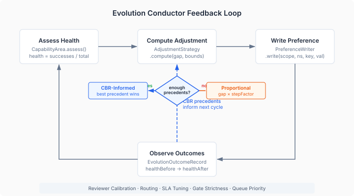
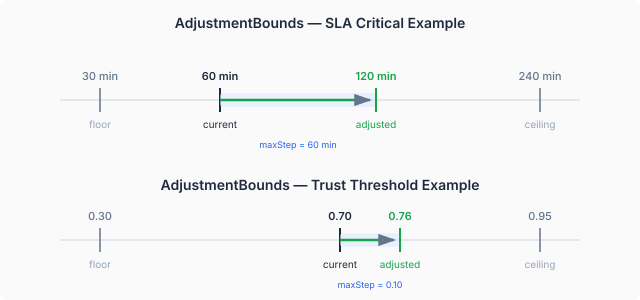

# The System That Tunes Itself

Most review systems ship with hardcoded thresholds. A trust score of 0.70 means an agent is qualified for security review. An SLA of 60 minutes means a critical review is overdue. A minimum of 10 observations means the routing engine has enough data to make trust-weighted decisions. These numbers are chosen once, during design, by someone who has never run the system in production.

They're wrong on day one. Not catastrophically wrong — the system works. But the SLA that felt reasonable during design turns out to be either so tight that half the reviews breach it or so loose that nobody notices when things slow down. The trust threshold that seemed appropriately cautious either filters out agents that would have been fine or lets through agents that aren't ready. The numbers work in the sense that they don't crash anything. They don't work in the sense that they're actually calibrated to what the system is experiencing.

The traditional fix is to make these things configurable and wait for a human to adjust them. That's a transfer of responsibility, not a solution. The human who adjusts the SLA threshold is doing the same thing the designer did — guessing, but with slightly more information.

What we built this week is different. The evolution conductor doesn't just expose knobs. It watches what happens after each adjustment and uses that history to make the next adjustment better.



## Five workers, one pattern

The conductor runs five specialised workers, each responsible for a different dimension of system health:

- **Reviewer Calibration** — trust thresholds, minimum observations, and borderline margins per capability
- **Routing Adjustment** — confidence thresholds that determine when routing falls back to human oversight
- **SLA Tuning** — breach windows for critical, high, and normal priority reviews
- **Gate Strictness** — minimum trust gates, human approval thresholds, and required review counts
- **Queue Priority** — batch sizes and concurrency limits for the merge queue

Every worker follows the same lifecycle. Assess health in its capability area. If health is above the target (0.6), decline — the system is performing well enough in this dimension, don't intervene. If health is below target, compute adjustments. Write them as preferences. Return the result for the conductor to review.

The uniformity matters. Each worker is a CDI bean with the same constructor signature: a `PreferenceWriter`, a `CapabilityArea`, and an `AdjustmentStrategy`. The strategy is the same instance for all five. The capability area is what varies — each one knows how to assess health for its specific domain. This isn't accidental consistency; it's a deliberate design that makes the system testable and the pattern legible.

## Two strategies, one decision point

The adjustment strategy has a clean split. When the system has enough historical data — enough outcomes from prior evolution cycles — it uses case-based reasoning to pick the adjustment that worked best in a similar situation. When it doesn't have enough data, it falls back to proportional adjustment: gap times a step factor, clamped to bounds.

```java
List<EvolutionOutcomeRecord> similar = precedents.stream()
    .filter(p -> Math.abs((targetHealth - p.healthBefore()) - gap) 
                 <= healthGapTolerance)
    .filter(p -> !Double.isNaN(p.healthAfter()))
    .filter(p -> p.adjustments().containsKey(parameter))
    .toList();

if (similar.size() < minPrecedents) {
    return fallback.compute(/* proportional */);
}

EvolutionOutcomeRecord best = similar.stream()
    .max(comparingDouble(p -> p.healthAfter() - p.healthBefore()))
    .orElseThrow();
```

The CBR strategy finds precedents where the health gap was similar to the current gap (within a tolerance), then picks the precedent that produced the largest health improvement. "What did we do last time we were in roughly this situation, and which of those attempts worked best?" It's not machine learning. It's not a neural network. It's a sorted filter over structured records. The power is in the feedback loop, not the algorithm.

The proportional fallback is the cold-start strategy. When you have no history — or not enough of it — you still need to make a move. The proportional strategy computes a delta from the gap between current health and target health, scaled by a step factor and constrained by bounds.

## Bounds: the structural guarantee

Every parameter adjustment is constrained by an `AdjustmentBounds` record:

```java
public record AdjustmentBounds(
    double floor,
    double ceiling,
    double minStep,
    double maxStep,
    double stepFactor,
    Direction direction) { }
```

This is where the domain expertise lives. Not in the algorithm, but in the constraints.



The SLA critical window has a floor of 30 minutes and a ceiling of 240. The maximum single-step adjustment is 60 minutes. The direction is `INCREASE_ON_LOW_HEALTH` — when review completion health is poor, give reviewers more time, not less. These aren't arbitrary limits. A 30-minute SLA floor means "we never want a critical review to have less than 30 minutes, no matter how healthy the system is." A 240-minute ceiling means "if critical reviews routinely take longer than four hours, the problem isn't the SLA."

The trust threshold bounds are different in character but identical in structure. Floor 0.30, ceiling 0.95, max step 0.10. You can't set the trust threshold below 0.30 (that would admit agents with almost no track record) or above 0.95 (that would exclude everyone). And you can't move it more than 0.10 in a single cycle — large jumps create oscillation.

This is the real design insight. The bounds encode operational invariants that no algorithm should be allowed to violate, regardless of what the data says. The CBR strategy might find a precedent where setting the trust threshold to 0.15 produced a massive health improvement — but the bounds won't let it go below 0.30, because operational experience says that's the absolute floor for a meaningful trust gate.

## The SLA constraint chain

The SLA worker has an additional structural constraint that the others don't need. Three SLA tiers — critical, high, normal — must maintain minimum gaps between them:

```java
if (high < critical + MIN_CRITICAL_HIGH_GAP) {
    high = critical + MIN_CRITICAL_HIGH_GAP;
}
if (normal < high + MIN_HIGH_NORMAL_GAP) {
    normal = high + MIN_HIGH_NORMAL_GAP;
}
```

Each tier is independently adjusted, but the results are post-processed to enforce ordering. A critical SLA of 90 minutes with a high SLA of 100 minutes is nonsensical — the gap between priority levels has to be wide enough that the escalation chain actually means something. The 30-minute and 60-minute minimum gaps encode that operational requirement.

This is a pattern worth advocating beyond this specific system. When you have multiple related parameters that an optimisation loop is tuning independently, validate the relationships between them after each cycle. Independent optimisation of coupled parameters without relationship constraints is how you get a system that's locally optimal in each dimension and globally incoherent.

## Where the data comes from, and where it goes

An `EvolutionOutcomeRecord` is four fields:

```java
public record EvolutionOutcomeRecord(
    String category,
    double healthBefore,
    double healthAfter,
    Map<String, Double> adjustments) {}
```

Health before the adjustment. Health after. What was changed. That's the minimum viable feedback signal. The `OutcomeQuery` functional interface retrieves these records by category, and the CBR strategy selects from them. When the evolution conductor runs a cycle and preferences are written, the system observes how health changes in the subsequent period. That observation becomes the next precedent.

Right now, the `PreferenceWriter` is a logging stub. Preferences are computed, validated against bounds, and logged — but not persisted. This is Phase 0. The domain model, the strategy pattern, the bounds constraints, and the worker lifecycle are all real. The persistence layer will follow. But the important thing is that the architecture doesn't change when persistence arrives — the `PreferenceWriter` interface is already the SPI boundary. Swap the implementation, and the system starts writing real preferences without touching any worker code.

## Why this matters beyond devtown

The pattern here is reusable for any system that has operational parameters that should converge toward good values over time:

1. **Assess health** from outcomes, not from parameter values. The parameter might be "right" and the health still poor — or vice versa.
2. **Constrain adjustments with domain bounds**, not with algorithm limits. The bounds encode what a human operator would never allow, regardless of what optimisation suggests.
3. **Use precedents when you have them, proportional adjustment when you don't.** The cold-start problem is real; don't let the absence of history paralyse the system.
4. **Validate cross-parameter relationships after each cycle.** Independent optimisation of coupled parameters produces incoherent configurations.
5. **Keep the feedback loop as a data structure.** `EvolutionOutcomeRecord` is a record, not a model. It's queryable, inspectable, and auditable.

The evolution conductor is the first CaseHub application where the system's own operational parameters are a case to be managed — assessed, adjusted, reviewed, and audited — using the same case management primitives that manage PR reviews. The review system reviews itself.
