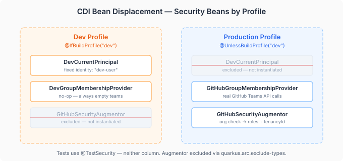
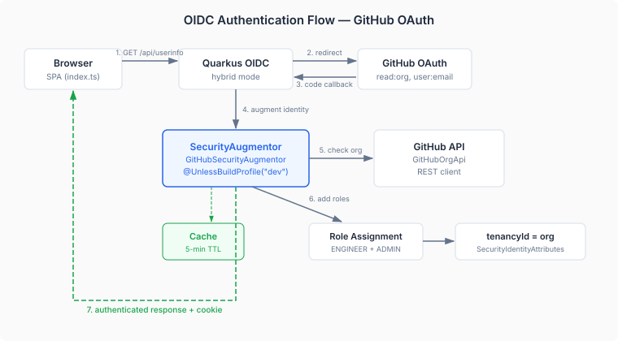

# The Augmentor That Doesn't Exist in Dev

Adding authentication to a dashboard sounds straightforward. Configure an OAuth provider, protect the API routes, redirect unauthenticated requests. Every framework has a getting-started guide for this. What none of those guides tell you is how to make the authenticated production system and the zero-friction dev experience coexist in the same codebase without one contaminating the other.

Devtown's PR review dashboard had been running without authentication since it started. In dev mode, you hit `localhost:8080`, and the dashboard loads. No login screen, no tokens, no redirect chain. This is correct for development — you're iterating on UI components, not testing OAuth flows. But the moment the dashboard is accessible to anyone outside your machine, the absence of authentication becomes the absence of authorisation. Not "who is this person?" but "what are they allowed to see?"

The challenge wasn't adding GitHub OAuth. Quarkus makes that a configuration block. The challenge was adding it in a way that doesn't break dev mode, doesn't leak security configuration into tests, and doesn't create a parallel universe of "authenticated code" and "unauthenticated code" that diverges over time.

## The three-profile problem

Authentication in a Quarkus application runs in three contexts, and each one needs different security behaviour:

**Dev mode** — no authentication. `DevCurrentPrincipal` provides a fixed identity. The developer never sees a login screen.

**Production** — full OIDC flow. GitHub OAuth with org membership checks, role assignment from team membership, cached lookups with a 5-minute TTL.

**Tests** — `@TestSecurity` annotations. No OIDC provider, no GitHub API calls, no dev-mode stubs. Each test declares exactly which principal and roles it expects.



The typical approach is `@DefaultBean` displacement — the same pattern devtown uses for `PrReviewService`, where the naive implementation has `@DefaultBean` and each successive layer displaces it with `@ApplicationScoped`. But security beans have a different constraint: they shouldn't just be displaced, they should be *absent*. A `SecurityIdentityAugmentor` that exists but is inactive is a bean that gets discovered, instantiated, and potentially injected into the wrong context. A `SecurityIdentityAugmentor` that doesn't exist in dev mode can't interfere with anything.

CDI build profiles give you exactly this:

```java
@ApplicationScoped
@UnlessBuildProfile("dev")
public class GitHubSecurityAugmentor 
    implements SecurityIdentityAugmentor { }
```

```java
@ApplicationScoped
@IfBuildProfile("dev")
public class DevCurrentPrincipal 
    implements CurrentPrincipal { }
```

`@UnlessBuildProfile("dev")` means the augmentor doesn't exist during Quarkus augmentation in dev mode. It's not excluded at runtime — it's excluded at build time. The CDI container never sees it. This is structurally different from a `@DefaultBean` that gets overridden: there's no override because there's no bean to override.

## What the augmentor actually does

The `GitHubSecurityAugmentor` sits in the Quarkus security pipeline between "OIDC verified your token" and "your SecurityIdentity is ready." It receives the identity that OIDC constructed from the GitHub access token, and it augments it with two things: roles and tenancy.



Roles come from two GitHub API calls: is this user a member of the configured org? If yes, they get `ENGINEER`. Are they a member of the admin team? If yes, they also get `ADMIN`. Tenancy comes from the org name itself — the GitHub organisation is the tenancy boundary. A user in `casehubio` sees `casehubio` data. This is the same `tenancyId` that flows through the entire CaseHub platform — from case creation through trust scoring to audit entries.

```java
private SecurityIdentity augmentBlocking(SecurityIdentity identity) {
    String login = identity.getPrincipal().getName();
    CachedMembership membership = resolveMembership(login);
    Set<String> roles = new HashSet<>(identity.getRoles());

    if (membership.isOrgMember) {
        roles.add(DevtownRoles.ENGINEER);
    }
    if (membership.isAdmin) {
        roles.add(DevtownRoles.ADMIN);
    }

    return QuarkusSecurityIdentity.builder(identity)
            .addRoles(roles)
            .addAttribute(SecurityIdentityAttributes.TENANCY_ID, githubOrg)
            .build();
}
```

The membership cache is a `ConcurrentHashMap` with a 5-minute TTL. Not a distributed cache, not Redis, not a database. A local in-memory map. This is deliberate — the augmentor runs on every authenticated request, and the GitHub API has rate limits. The cache means the first request for each user hits GitHub; the next 300 seconds don't. If GitHub returns a transient error (a 500, a rate limit) and the cache has a prior result, the augmentor uses the cached result rather than revoking access. You don't lose your dashboard session because GitHub had a bad minute.

## The frontend contract

The SPA side is minimal. On load, the app calls `GET /api/userinfo`. If it gets a 200, the user is authenticated — parse the response for roles and tenancy, mount the dashboard. If it gets a 401, redirect to `/api/userinfo` with a full page navigation. Since OIDC is configured as `hybrid`, Quarkus intercepts the 401 on the server side and redirects to GitHub's OAuth flow. After the user authorises, they're redirected back with a cookie, and the next `GET /api/userinfo` succeeds.

```typescript
async function start() {
  const userRes = await fetch("/api/userinfo");
  if (userRes.status === 401 || !userRes.ok) {
    window.location.href = "/api/userinfo";
    return;
  }
  const user: UserInfo = await userRes.json();
  // mount dashboard with user.tenancyId and roles
}
```

The `authFetch` wrapper does the same 401 check on every API call. If a session expires mid-use, the next API call triggers re-authentication rather than showing a cryptic error. No refresh tokens, no silent renewal, no client-side token management. The server owns the session; the client owns the redirect.

## Path-based permissions, not annotation soup

The permission model is path-based in `application.properties`:

```properties
%prod.quarkus.http.auth.permission.api-default.paths=/api/*
%prod.quarkus.http.auth.permission.api-default.policy=authenticated

quarkus.http.auth.permission.github-webhook.paths=/api/github/*
quarkus.http.auth.permission.github-webhook.policy=permit

quarkus.http.auth.permission.health.paths=/q/*
quarkus.http.auth.permission.health.policy=permit
```

`%prod.` scoping on the default API policy is critical. Tests use `@TestSecurity` to inject a principal — they don't use OIDC at all. If the `api-default` policy applied during tests, every `@QuarkusTest` endpoint call would get a 401 before `@TestSecurity` could inject anything.

GitHub webhooks are explicitly permitted — they're HMAC-verified internally, not OIDC-authenticated. Health endpoints are open. MCP and Qhorus endpoints require authentication. Everything else under `/api/*` requires authentication in production and is open in dev mode.

This is a design choice worth defending. Annotation-based security (`@RolesAllowed` on every JAX-RS resource) couples the security policy to the code. A new endpoint without the annotation is silently unprotected. Path-based security in configuration means the default is "authenticated" and exceptions are declared — a new endpoint is protected by default unless you explicitly permit it. It's fail-secure rather than fail-open.

## Test isolation

The test profile doesn't use dev-mode beans or production beans. It uses neither. The augmentor and group membership provider are explicitly excluded:

```properties
quarkus.arc.exclude-types=...,\
  io.casehub.devtown.app.spi.GitHubSecurityAugmentor,\
  io.casehub.devtown.app.spi.GitHubGroupMembershipProvider
```

Tests that need a specific principal use `@TestSecurity(user = "test-user", roles = {"ENGINEER"})`. Tests that need to verify CDI displacement use `CdiDisplacementTest`, which asserts that the resolved `CurrentPrincipal` in the test profile is `FixedCurrentPrincipal`, not `DevCurrentPrincipal`.

This three-way isolation — dev beans excluded in test, production beans excluded in test, test infrastructure excluded from both — is what prevents the authentication layer from creating ripple effects. You can change the GitHub org check logic without re-running tests that don't care about authentication. You can add a new test security scenario without touching the augmentor. The three contexts are genuinely independent, not just decoupled by naming convention.

## GitHub organisation as identity boundary

The decision to use GitHub org membership as the identity boundary — rather than a separate user database, or LDAP, or an invitation list — is a domain decision, not a technical one. Devtown coordinates PR reviews for GitHub repositories. The people who should have access to the dashboard are the people who work on those repositories. Those people are already members of the GitHub organisation. There's no reason to maintain a parallel identity system.

The org becomes the tenancy. The team structure within the org becomes the role hierarchy. `devtown-admins` is the admin team — membership in that team grants `ADMIN`. Everything else is `ENGINEER`. This is intentionally flat. Devtown isn't an enterprise RBAC system. It's a coordination system for people who already trust each other enough to share a GitHub org. The authentication layer reflects that trust relationship rather than trying to impose a more granular one.

The `GroupMembershipProvider` implementation — `GitHubGroupMembershipProvider` — converts GitHub team membership into the platform's `GroupMember` abstraction. This is how the CaseHub work system knows who can be assigned to human review tasks: it asks the group membership provider for the members of a team, and it gets back GitHub logins. No parallel user table. No sync job. The GitHub team is the source of truth, queried live.

## The lesson

Authentication in a multi-profile application isn't about "adding a login screen." It's about maintaining the invariant that each execution context — dev, test, production — has exactly the security beans it needs and none of the ones it doesn't. Build-time profile exclusion (`@IfBuildProfile`, `@UnlessBuildProfile`) is structurally stronger than runtime displacement (`@DefaultBean`), because an excluded bean can't interfere — it doesn't exist. A displaced bean still exists in the container, inactive but discoverable.

The broader CaseHub principle this reinforces: platform identity boundaries should come from the systems the users already live in. Don't build a user database when your users already have a membership list. Don't build a role hierarchy when your users already have team structure. Reflect the existing trust topology rather than creating a parallel one.
