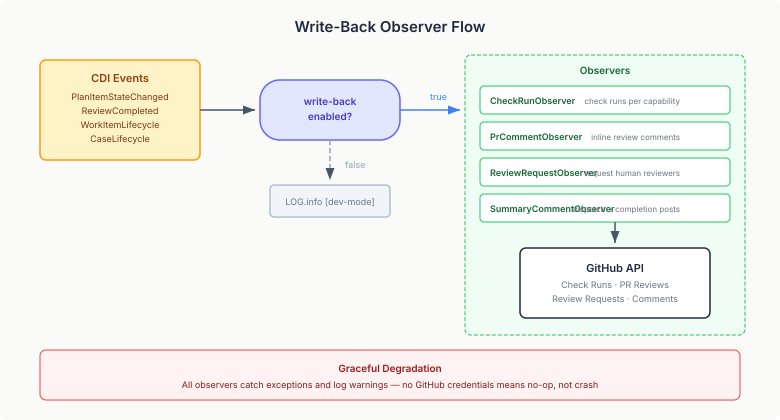

# Closing the Write-Back Loop

Devtown has had four GitHub write-back observers since the early layers — `GitHubCheckRunObserver`, `GitHubPrCommentObserver`, `GitHubReviewRequestObserver`, `GitHubSummaryCommentObserver`. Each one watches a different CDI event, translates it into the corresponding GitHub API call, and closes the feedback loop between devtown's case engine and the PR that triggered the review. Check runs show per-capability status. Inline comments place findings at the exact file and line. Review requests pull humans in when the case plan fires a `human-decision:pr-approval` gate. Summary comments give the PR author a single narrative of what was dispatched and what the outcome was.

All four have been tested and wired since they were written. But they've been dormant — gated behind `devtown.github.write-back.enabled`, defaulting to `false`. In dev mode they log what *would* happen and return early. The config flag existed precisely so we could build and test the observers without accidentally posting to real PRs during development.

The work today was turning the flag on.

## What Changed

One line in `application.properties`:

```properties
%dev.devtown.github.write-back.enabled=true
```

Dev profile only. The observers still default to `false` in production (requires explicit opt-in) and remain off in CI (no GitHub API available). The observers already handle missing credentials gracefully — every API call is wrapped in `try/catch` with a `LOG.warnf`, so running in dev mode without a GitHub token just means silent no-ops instead of crashes.



## The CDI Proxy Surprise

The interesting discovery was in the existing test suite. `GitHubWriteBackWiringTest` had a test called `writeBackIsDisabledByDefault` that asserted `prCommentObserver.enabled` was `false`. The test passed. It had always passed. But it was a false positive.

The problem: `@ApplicationScoped` beans in Quarkus are CDI proxies. When you access a field on a proxy, you get the proxy's own uninitialised field — not the injected value on the real bean behind it. For a `boolean`, uninitialised is `false`. The test was asserting `false == false` and declaring victory, regardless of what the actual config value was.

We caught this because the new enabled-path test — which needed to assert `true` — failed for the same reason. The proxy's field was `false` no matter what the profile said. The fix was straightforward: inject the config property directly via `@ConfigProperty` instead of reading the proxy's field. Both tests now verify the config layer, not the Java default for `boolean`.

## Unblocking the Build

The CDI proxy issue surfaced a second pre-existing problem. Five `CapabilityArea` beans in the evolution package — `SlaComplianceCapabilityArea`, `ReviewQualityCapabilityArea`, `MergeQueueHealthCapabilityArea`, `ReviewerTrustCapabilityArea`, `CiReliabilityCapabilityArea` — were all `@ApplicationScoped` but had no no-args constructor. Their parent class `EventRatioCapabilityArea` only declared a constructor taking `EventLogRepository`, which CDI uses for injection, but the proxy subclass needs a no-args constructor to exist.

Every `@QuarkusTest` in the repo was failing. Adding protected no-args constructors to the parent and all five subclasses unblocked the entire test suite.

## What This Opens Up

With write-back enabled, the next step is running devtown against a real PR and watching the observers fire end-to-end. The observers are the last piece of epic #247 (wire real LLM agents) that bridges into epic #223 (agents post findings on GitHub PRs). Once findings flow through the case pipeline, they become visible as check runs and inline comments on the PR itself — which is the whole point of the accountability layer.

The `GitHubPrDiffClient` is still excluded from the CDI container. Removing that exclusion would let the content-analysis binding read real PR diffs from GitHub instead of relying on webhook payloads. That's a separate issue — the observers don't need it to function, and enabling it requires validating the diff client's auth path against both token and GitHub App credentials.
