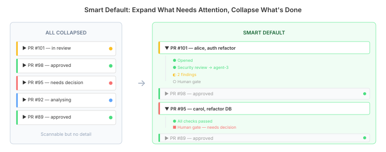
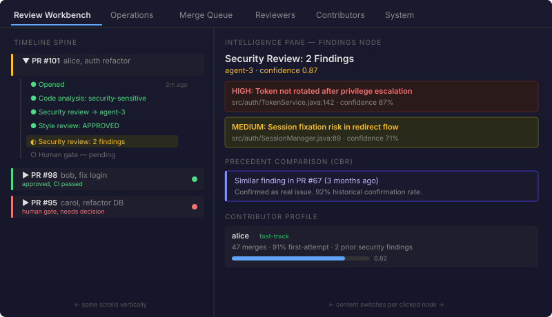
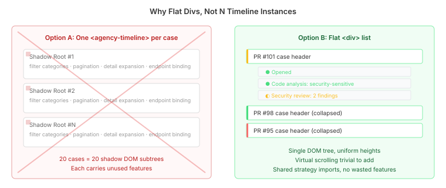
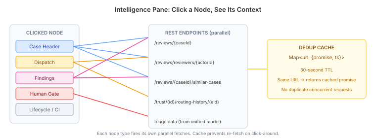

# The Review Intelligence Workbench: What GitHub Can't Show You About Your PR

GitHub shows you a diff. DevTown shows you what you need to know *about* that diff.

That's the one-sentence pitch for the Review Intelligence Workbench — the UI overhaul I built today for DevTown's governance layer. The backend intelligence has existed for months: trust-weighted routing rationale, CBR precedents from similar past PRs, contributor history with GitHub profile data, policy context explaining why *this* reviewer was selected for *this* capability. The gap was that none of it was surfaced coherently. The old PR Cases tab was a flat list with a detail pane — structurally identical to what you'd find in any project management tool. Click a PR, see its status. Fine for tracking. Useless for *understanding*.

## The Questions GitHub Can't Answer

A code reviewer — human or AI — looking at a PR needs to answer questions that no diff viewer provides:

- Has this contributor had security findings on similar code before?
- Why was *this* agent selected for the security review, and who else was considered?
- The agent found two findings — how often do similar findings turn out to be real issues in this codebase?
- There's a human approval gate — what does the human actually need to decide, and how has this candidate group decided similar reviews historically?

All of this data existed in DevTown's services. `ContributorDetail` had the merge history and GitHub intelligence. `CbrRetrievalService` could find analogous past PRs and their outcomes. `TrustQueryService` had the routing rationale with candidate alternatives and scores. The intelligence was computed and stored — just not visible.

## Arriving at the Design

I started with the interaction model, not the components. The fundamental question: what is the primary object a reviewer navigates? In GitHub, it's a list of PRs. In DevTown, I wanted it to be **decision events** — the moments where the system made or awaits a choice. A PR isn't one thing to review; it's a sequence of decisions. Opened. Analysed. Dispatched to a security reviewer. Findings reported. Human gate activated.

Claude and I brainstormed before/after mockups in a browser-based visual companion — side-by-side layouts showing the old flat list against the proposed timeline spine. The before: a sortable table with PR rows. The after: stacked case lifecycles with clickable decision nodes.

The first mockup showed every case fully expanded with its timeline nodes. It looked right for three cases. At twenty, it was overwhelming. I asked Claude to mock up a collapsed mode — each case compressed to a single row with a status indicator, expandable on click. That raised the question: what should the *default* be?

Three options: all collapsed (scannable but hides the flow), all expanded (the vision but doesn't scale), or smart — expand cases with active work, collapse completed ones. The smart default won. A case with an in-progress review or pending human decision expands automatically. A case where everything is approved or completed collapses to a single line. The spine adapts to volume without manual management.

That interaction model drove fourteen design decisions, each documented with alternatives and trade-offs. An adversarial review challenged them — and caught real issues. The reviewer pointed out that ops leads during incidents need the flat sortable list for scanning thirty PRs by wait time. The spine alone wouldn't serve that scenario. So the design gained a table toggle — the spine is the default, but a chip switches to the dense table view. Both share the same data source and selection mechanism. Click a row in either view and the intelligence pane fills with context.

## The Timeline Spine

The core interaction model is a two-pane layout. The left side is the timeline spine — a vertical flow of active cases. The right side is the intelligence pane.

Each case in the spine shows its lifecycle as clickable nodes: `● Opened`, `● Code analysis: security-sensitive`, `● Security review → agent-3`, `◐ Security review: 2 findings`, `○ Human gate — pending`. These labels are synthesised from event metadata by a dedicated `spineNodeStrategy` — combining event type, capability name, and actor into compact human-readable summaries. Click any node, and the right pane fills with contextual intelligence for that specific moment.

The coloured left border on each case row reflects its overall status at a glance: blue for early-stage analysis, yellow for in-progress review, red for human attention needed, green for approved.

### Why Flat Divs Beat Component Composition

The first architectural instinct was to stack one `agency-timeline` component per case. The existing timeline component handles event ordering, category filtering, pagination, and detail expansion. Wrapping twenty of them in a scrollable container sounds reasonable.

It's wrong for this use case.

Each `agency-timeline` creates its own shadow DOM subtree with filter state, pagination logic, and endpoint binding — features the spine doesn't need. The spine is a flat list of case headers and event nodes. The per-case features are exactly what *shouldn't* happen here, where the goal is compactness and fast scanning.

The spine uses the `spineNodeStrategy`'s data model (event categories, icon mapping) as plain imports from the shared `reviewTimelineStrategy` — the synthesis logic is strategy-specific, but the vocabulary is shared. The full `agency-timeline` with `reviewTimelineStrategy` remains available in the intelligence pane for the detailed event view. Right component at the right layer.

The flat-div approach also makes virtual scrolling trivial to add later. Uniform-height divs in a single DOM tree are a standard windowing problem. Heterogeneous component subtrees with independent shadow roots would require recreating instances during scroll — defeating the purpose.

## The Intelligence Pane

Click a node, see its context. The intelligence pane is a single component that switches content based on node type:

**Case header** — click the PR itself. See the contributor's trust profile with intake lane classification, CBR precedents (past PRs with similar code changes and what happened), code classification, and the routing policy that determined how this PR would be reviewed.

**Dispatch node** — click "Security review → agent-3". See why agent-3 was selected: trust score for the security-review capability, open commitment count, and — for completed reviews — the full candidate list with scores showing who else was considered and why they were excluded. This two-tier approach emerged from the review process: `WorkerDecisionEntry` records are written on worker completion, not at dispatch time. For in-progress dispatches, the intelligence pane shows basic rationale from event metadata and the agent profile. After completion, the full candidate scoring becomes available.

**Findings node** — click "Security review: 2 findings". See the findings with severity, confidence, and file locations. Below that, CBR precedent comparison: "Similar finding in PR #67 three months ago — confirmed as real issue. 92% historical confirmation rate for token rotation findings in this codebase." That confirmation rate is computed client-side from the precedent pool — as the casebase grows, it becomes genuinely predictive.

**Human gate** — click the pending human decision. See what needs deciding, who the candidate group is, the work item's SLA status, and how this group has decided similar reviews historically.

Each view fires parallel REST fetches — no waterfall. A lightweight dedup cache (`Map<url, {promise, timestamp}>` with thirty-second TTL) prevents duplicate requests during click-around. Click a dispatch node, click the case header, click the dispatch again — the second dispatch returns cached data instantly.

## What the Review Caught

I started with the assumption that no backend changes were needed — the intelligence data was already served by existing endpoints.

The spec review caught two gaps.

First, `CbrRetrievalService.findSimilar()` was only exposed through the MCP/GraphQL layer. No REST endpoint for the frontend to call with `fetch()`. I added `GET /api/devtown/reviews/{caseId}/similar-cases` to `DevtownReviewApi` using the `@McpDomain` pattern — it extracts PR parameters from the case's payload, so the frontend only passes the case ID.

Second, the dispatch intelligence view needs routing rationale with candidate alternatives, which lives in `WorkerDecisionEntry` records. The existing `RoutingDecision` record only carried `(capability, reason, confidence, bindingName)` — no link back to the entry with full candidate scoring. I enriched the record with an `entryId` field, correlated by case ID and capability tag. For in-progress dispatches the entry doesn't exist yet, so `entryId` is null and the pane shows "Full rationale available after review completes."

Both were genuine blind spots in the original spec — the kind of gap that only surfaces when you trace the exact data path from backend through REST to frontend rendering.

## The Tab Restructure

The old six-tab layout mixed operational monitoring with review intelligence with debug tools. The new layout separates by daily-use purpose:

| Before | After |
|--------|-------|
| PR Cases | **Review Workbench** (spine + intelligence) |
| Reviewers | Reviewers (unchanged) |
| Contributors | Contributors (unchanged) |
| Workers | *removed — sessions fold into Operations* |
| System | System (refocused on calibration) |
| Definitions | *removed — accessible via URL* |
| — | **Operations** (problems, events, sessions) |
| — | **Merge Queue** (dedicated queue view) |

The Merge Queue tab is the key structural change beyond the workbench. Queued PRs and review-lifecycle cases used to share the same list, differentiated by filter chips. Now they're in separate tabs with distinct components — the Review Workbench scopes to review-lifecycle cases, the Merge Queue shows queued PRs, active batches, and queue metrics with its own split-pane layout using `pr-detail` in queue/batch mode.

## The Argument for Review Intelligence

GitHub's review interface assumes a reviewer knows what they need to know. The diff is presented; the reviewer brings context from memory, experience, and whatever they can find in the commit history. This works for small teams where everyone knows the codebase and the contributor.

It breaks at scale. When you have a fleet of AI reviewers with different trust profiles, a contributor population with varying quality histories, and a codebase where certain file paths have a track record of security issues — the reviewer needs *supplied* context, not *remembered* context. The intelligence isn't optional; it's the difference between a reviewer who catches the token rotation issue because CBR precedents show a 92% confirmation rate, and a reviewer who dismisses it because the code looks syntactically fine.

DevTown doesn't replace the diff viewer. It wraps the review process in an accountability layer where every routing decision, every trust score, every precedent comparison is visible and traceable. The Review Workbench makes that layer accessible — not as a dashboard of metrics, but as contextual intelligence tied to the specific decision event the reviewer is looking at.

The intelligence pane's architecture — node-type switching with parallel fetches — handles new node types without structural changes. When DevTown adds cross-repo coordinated merges, coordination events will appear as spine nodes with their own intelligence views. The pattern scales because the pane doesn't know about node types at a structural level — it's a switch statement over a known, small set. Adding a new type is adding a case, not rebuilding the component.
