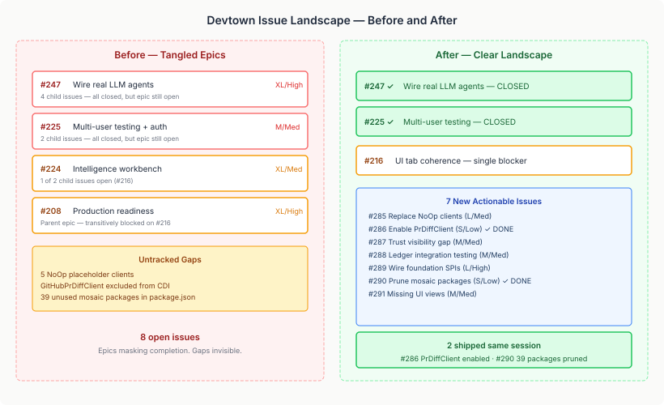

# The Audit That Closed Two Epics

There's a pattern I keep seeing in long-running projects. You ship a feature, close the child issues, and move on. The parent epic stays open because nobody goes back to check. Weeks pass. The epic accumulates a gravity of its own — it looks like a wall of unfinished work to anyone scanning the backlog, even when the work is done.

Devtown had exactly this problem. Four open epics, two open leaf issues, and a backlog that suggested the project was mid-build. The reality was different: most of the work was finished. The epics were tombstones waiting for someone to notice.

## What the Audit Found

I ran a structured review across the whole casehubio org — codebase gaps, cross-repo state, frontend dependencies, and the four open epics.

**Epic #247 (Wire real LLM agents)** had four child issues: #257, #258, #259, #260. All closed. The simulation backend works. Real LLM backends activate when credentials are present. GitHub write-back posts findings as inline PR comments. The epic's definition of done was met. It had been met for weeks. Nobody closed it.

**Epic #225 (Multi-user testing + production auth)** — same story. Two child issues, both closed. Webhook replay, OIDC auth, dev-mode unauthenticated, GroupMembershipProvider — all shipped.

Both closed now.

**Epic #224 (Intelligence workbench)** is blocked on exactly one issue: #216 (UI tab coherence). **Epic #208 (Production readiness)** is a parent that closes when #224 closes. The four-epic wall turns out to be one issue deep.

## The Gaps Nobody Filed Issues For

The codebase review turned up seven concrete improvements that had no tracking. Some were known informally — the kind of thing you mention in a commit message or a code comment — but none had an issue, a scale estimate, or a place in the priority queue.

**Five NoOp placeholder clients** sit in the production codebase: `NoOpRevertClient`, `NoOpCiStatusClient`, `NoOpBatchBranchClient`, `NoOpMergeClient`, `NoOpContributorHistoryClient`. Each one is a `@DefaultBean` stand-in for a real GitHub-backed implementation. They've been there since the early layers. They work — in the sense that they don't crash. They don't do anything, which is the problem. The merge queue can't actually merge without a real merge client. CI status checks can't query real CI. These are the gap between "the architecture works" and "the system works."

**The ledger write path is completely untested** in devtown context. `casehub.ledger.enabled=false` in every test configuration. The ledger beans are CDI-wired, the Merkle audit infrastructure exists, GDPR erasure is implemented — but no integration test in devtown verifies any of it actually writes a record.

**The trust visibility gap** — two TODOs in `TrustQueryService` where `TrustScoreSnapshot` was removed from the ledger SNAPSHOT. Before/after trust scores are unavailable in the governance UI. The data model exists. The query doesn't.

**Foundation SPIs landed but unwired** — `TriageHandler` (platform #673), `PlaybookWorkerFunctionProvider` (engine #1263), structured HTTP agent sidecar (platform #666), protocol lifecycle hooks (qhorus #497). Each of these replaces a custom implementation pattern with a platform-standard one. They're available. Devtown doesn't use them yet.

All seven are now tracked as issues (#285–#291) with scale and complexity estimates.

## Two Quick Wins, Same Session

Two of the seven were S/Low — small enough to ship immediately.

**#286: Enable `GitHubPrDiffClient`.** The real PR diff client has existed since the early layers. It was excluded from the CDI container with a single entry in `quarkus.arc.exclude-types`, leaving `DevModePrDiffService @DefaultBean` to serve synthetic diffs. The fix was removing one class name from a comma-separated list. The displacement test confirms `GitHubPrDiffClient` now wins over the `@DefaultBean` fallback.

**#290: Prune 39 unused mosaic packages.** The frontend's `package.json` declared 45 mosaic packages as dependencies. Only 3 were imported anywhere in the source code (`agency-timeline`, `session-workbench`, `evolution-workbench`). The other 39 were cargo from an earlier phase where the plan was to wire all the mosaic components. The frontend was built with custom components instead — better-suited to devtown's data model. The 39 packages were dead weight: slowing `npm install`, obscuring what the frontend actually uses, and giving a false impression of the mosaic integration surface.

## Why This Matters

The interesting thing about today's work isn't any individual change. It's the compounding effect of not doing it.

Open epics that should be closed create false signals. A product manager scanning the backlog sees four epics and concludes the project is 60% done. A new contributor sees the same backlog and thinks there's a mountain of work. Both are wrong, but the backlog doesn't tell them that — it takes reading every child issue to discover the epics are shells.

Untracked gaps create false confidence. The build passes. The tests pass. The architecture diagram shows all the boxes connected. But five of those boxes are `NoOpClient` and the ledger write path has never been tested end-to-end. The gap between "it compiles" and "it works in production" lives in untracked issues.

Unused dependencies create false complexity. 39 packages in `package.json` that nobody imports is 39 names a new contributor has to evaluate. "Do I need to understand mosaic-commitment-viz to work on this codebase?" No. But the dependency list doesn't say that.

The fix in each case is the same: look at what's actually there, compare it to what the tracking says, and close the gap. The audit takes an hour. The false signals compound for months.
