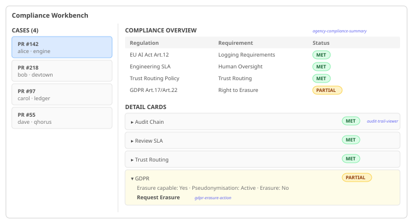
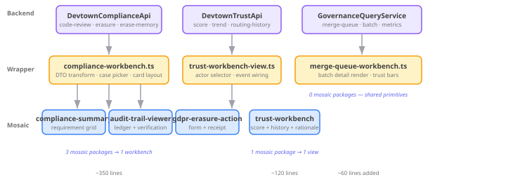
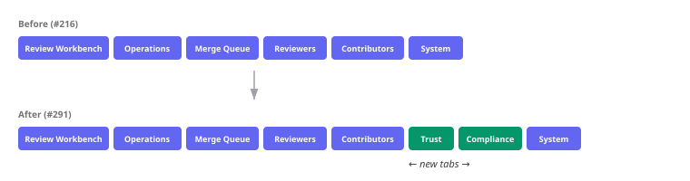

# The Audit Trail Nobody Reads

DevTown verifies Merkle chains on every merge decision. It tracks trust scores through Bayesian updates after every gate attestation. It records GDPR erasure capability status per review case. It knows which reviewer was selected, who else was considered, and why the policy excluded the alternatives.

None of this was visible in the UI.

The data existed as REST responses that no human ever called. If an auditor wanted to check whether a PR review met EU AI Act logging requirements, they had to know the endpoint path, call it with `curl`, and parse the JSON themselves. If a team lead wanted to understand why a specific agent kept getting selected for security reviews, they had to query four different trust endpoints and correlate the results manually.

An audit trail that requires `curl` to inspect is not an audit trail — it's a liability dressed up as diligence.

## The Regulatory Surface Area

This isn't academic. Automated code review is becoming production infrastructure, and the regulatory landscape is catching up.

The EU AI Act (Article 12) requires logging of automated decision-making systems. GDPR Articles 17 and 22 require right-to-erasure capability and transparency about automated decisions. These aren't future concerns — they apply now to any system that makes automated decisions affecting people's work.

DevTown's backend already computes compliance evidence. `CodeReviewComplianceEvidence` returns four structured sections per case: audit chain (Merkle tree root, chain verification status, ledger entries with digests), review SLA (task ID, claim deadline, completion timestamp, whether the SLA was met), trust routing (policy thresholds, candidate alternatives, selection rationale), and GDPR (erasure capability status, pseudonymisation state, receipt IDs). Every field is populated from real system state, not synthetic compliance metadata bolted on after the fact.

The problem was never computation. The problem was access. An auditor asking "show me the compliance posture of this PR review" had to run an investigation, not a query.

## Making Compliance Inspectable

The compliance workbench puts a case list on the left and evidence on the right. The top section is a requirement grid — four rows, one per regulatory concern, each with a status badge: MET, PARTIAL, GAP, or BREACHED. An auditor sees the compliance posture of any case in one glance.

Below the grid, four collapsible detail cards. Expand the audit chain card and the `audit-trail-viewer` component renders the full ledger entry table with a verification banner — Merkle root hash, chain integrity status, per-entry digests and attestations. This is the same data that would satisfy an Article 12 audit, rendered in a way that a compliance officer can actually navigate.

Expand the GDPR card and the `gdpr-erasure-action` component provides the erasure workflow directly — subject lookup, reason selection, confirmation dialog, receipt. An erasure request that used to require a POST to `/api/devtown/compliance/erasure/{actorId}` with the right headers is now a form with a confirmation step.

One click to see the case. One glance to see the posture. Drill into whichever requirement needs attention. The compliance data was always computed; now it's inspectable.

## Trust Routing: The Decision Your Reviewer Doesn't Know About

When DevTown dispatches a security review to agent-3, the routing decision is invisible to everyone except the log. Why agent-3 and not agent-1? Because agent-3's trust score for `security-review` is 0.78 with 42 observations in QUALIFIED phase, while agent-1 is at 0.65 with 12 observations in BORDERLINE. The policy threshold is 0.70 with a borderline margin of 0.05. Agent-1 was excluded; agent-3 was selected.

This rationale existed in `TrustQueryService` as structured data — trust scores by capability, routing history with candidate alternatives, gate decisions with trust score deltas. The Reviewers tab showed aggregate trust scores per agent. The intelligence pane showed routing rationale for individual dispatches. But there was no place to ask the actor-scoped question: "What is the full trust profile for agent-3, across all capabilities, over time?"

The trust workbench answers that. Select an actor from the dropdown. The mosaic `trust-workbench` composite renders the full profile — global score with per-capability breakdown, routing history table filterable by capability, and for any selected decision, the complete rationale: who was selected, who else was considered, what the policy thresholds were, what gate decisions followed with their trust score deltas.

This matters practically because trust-weighted routing is only as good as human ability to oversee it. If a reviewer is consistently selected for security reviews but their false-positive rate is climbing, someone needs to notice. If a reviewer's trust score dropped after three DECLINED outcomes and the routing policy excluded them from borderline-confidence dispatches, someone needs to understand why. The trust workbench makes these patterns visible — not as aggregate metrics, but as traceable decision histories.

## The Composition Payoff

Three views, three different composition densities. This is where the mosaic component model pays for itself.

The compliance workbench composes three mosaic packages — `compliance-summary` for the requirement grid, `audit-trail-viewer` for the ledger detail, `gdpr-erasure-action` for the erasure form. The devtown wrapper handles DTO transformation (flattening four evidence sections into a `RequirementDefinition[]` array for the grid), manages the case list, and lays out the collapsible cards. About 350 lines total.

The trust workbench wraps one mosaic package — `trust-workbench` — which is itself a composite of `trust-score-panel`, `trust-feedback-display`, `routing-rationale`, and `list-pane`. The devtown wrapper adds actor selection from the reviewer fleet endpoint and cross-tab navigation events. About 120 lines.

The merge queue enhancement adds no mosaic packages at all. It extends the existing batch detail rendering with bisection state fields using shared primitives already in the codebase — `renderTrustBar()` and `renderBadge()`. About 60 lines added.

The ratio is the point. The most novel view — compliance, an entirely new domain concern — needed the least proportional custom code, because the mosaic packages handle the domain rendering. The mosaic `trust-workbench` was designed alongside the trust API; the `TrustScoreResponse` shape matches what `trust-score-panel` expects because both emerged from the same domain model. The wrapper's job is actor selection and navigation, not data transformation or rendering logic.

This is the practical argument for component libraries designed against domain APIs rather than generic UI primitives. When the component knows the domain, the application code that wires it up is minimal. When it doesn't, every view is a custom build.

## The Bisection Suspect

One detail from the merge queue enhancement worth calling out: the suspect PR indicator during bisection.

DevTown's merge queue batches PRs and tests the tip of the batch first. If the tip passes, the batch merges. If it fails, the queue enters bisection — splitting the batch to identify the faulty PR. The `ActiveBatchEntry` carries a `suspectedPr` field that identifies the current bisection suspect.

Before this change, the merge queue workbench showed active batches as rows with PR count and CI status. The bisection state — which PR is suspected, what the bisection strategy is, what each member's trust score looks like — was invisible. An operator watching a bisection in progress had to check the API to know which PR was under suspicion.

Now clicking a batch shows the bisection strategy badge ("trust-weighted"), the risk level (colour-coded: HIGH in red, MEDIUM in amber, LOW in green), and a suspect PR warning when bisection has identified a candidate. The member table shows each PR with its trust score bar and priority lane badge. The suspected PR row is highlighted — red background, left border — so during an active bisection, the operator sees immediately which PR the system suspects and what its trust profile looks like.

Small change. The data was always there. The human needed to see it.

## The Industry Gap

GitHub Copilot reviews code. Amazon CodeGuru reviews code. Every major platform is adding AI-assisted review capability. The question none of them answer well: how do you audit the reviewer?

When a human reviewer approves a PR, accountability is implicit. The reviewer's name is on the approval; their reputation is the mechanism. When an AI reviewer approves a PR, what's the accountability mechanism? A log entry that "agent-3 approved PR #142" tells you what happened but not whether it should have happened. It doesn't tell you whether agent-3 was the right choice, whether higher-trust alternatives existed, whether the selection followed policy, or whether the agent's trust profile warrants the confidence the system placed in it.

This is the gap between automated and accountable. Automated means the system makes decisions. Accountable means the system can explain those decisions to a human who can verify whether they were correct — and that explanation is accessible, not buried in API responses.

The tab bar grew from six to eight. Trust and Compliance sit between Contributors and System — grouping actor-related views together, with compliance as a distinct auditor concern before the system configuration tab. Eight tabs for a professional governance workbench is reasonable — each serves a different audience (reviewer, operator, auditor, administrator) with a different question.

The compliance workbench shows the four regulatory requirements the system claims to satisfy, per case, with drill-down evidence for each. The trust workbench shows the routing decision history that built each agent's trust score, with every gate attestation and trust delta. The merge queue shows the bisection state that determines which PR is suspected when a batch fails.

The intelligence was computed. The compliance was tracked. The trust was scored. Making it visible is what makes it real.
