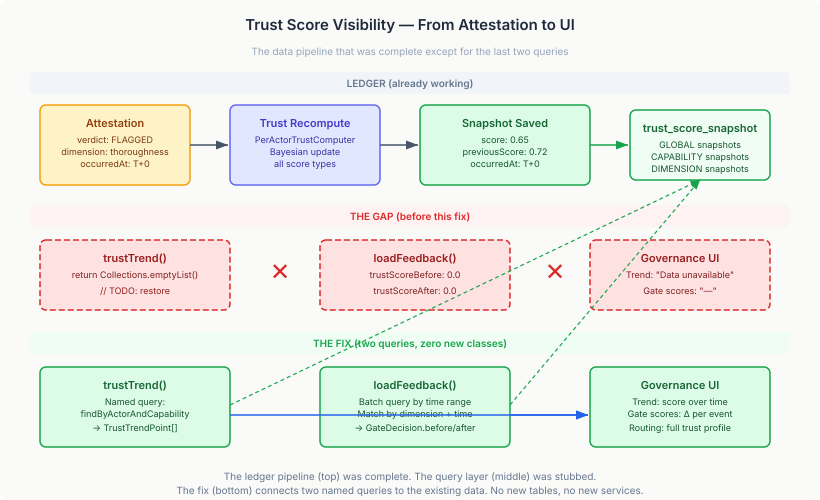

# The Query That Was Always There

If you deploy a trust-weighted reviewer assignment system and you can't show anyone how trust scores change over time, you don't have a trust system. You have a black box that happens to use maths.

DevTown has been routing code review assignments based on trust scores since Layer 6 shipped in May. A PR comes in, the engine evaluates reviewer candidates by capability, the trust-weighted selection strategy picks the one with the highest composite score above the policy threshold, and the assignment goes out. When the review completes, an attestation records the outcome — SOUND, FLAGGED, ENDORSED, or CHALLENGED — and the ledger's Bayesian trust computer updates the reviewer's scores. The next assignment uses the new scores. The loop is closed.

Except the loop was only closed for the machine. For humans looking at the governance UI, trust was a number that existed at a point in time. You could see that agent-3's security-review score was 0.78 right now. You could not see that it was 0.65 two weeks ago, that it climbed through 14 SOUND attestations, or that it dipped briefly after two FLAGGED incidents before recovering. And when you drilled into a routing decision to see the gate attestations, every trust score delta read 0.0 → 0.0. The attestation event was visible; its impact on trust was invisible.

## The Gap Was Not Where Anyone Thought

The two TODOs in `TrustQueryService` said the same thing: "TrustScoreSnapshot removed from ledger SNAPSHOT — restore when replacement entity available."

This was wrong. `TrustScoreSnapshot` was never removed from the ledger. The entity exists in `ledger-jpa-common` with a full set of JPA named queries. The SPI has six query methods. There's a JPA implementation, an in-memory implementation, and a no-op fallback. `PerActorTrustComputerCore.computeForActor()` saves snapshots — GLOBAL, CAPABILITY, DIMENSION, and CAPABILITY_DIMENSION — on every trust recomputation. The data has been accumulating in the `trust_score_snapshot` table since the ledger was wired.

What happened was a transient build issue. At some point during development, the ledger SNAPSHOT dependency didn't resolve correctly. The developer working on `TrustQueryService` couldn't import `TrustScoreSnapshot`, wrote a TODO, moved on. The build issue was fixed. The TODO stayed. The method returned `Collections.emptyList()`. The UI rendered "Data unavailable." Nobody noticed because the system worked — assignments went out, reviews came back, trust scores updated. The visibility gap was silent.

## Why Trust Visibility Matters

Trust-weighted routing is not new. Reputation systems have been studied extensively in multi-agent systems, marketplace design, and peer review networks. What's less commonly discussed is the oversight problem: a trust system that routes correctly but opaquely is worse than one that routes naively but transparently.

Consider the practical failure mode. An AI reviewer has a trust score of 0.78 for security reviews and gets consistently selected. Its score was built from 42 observations. But 15 of those observations are from three months ago, when the agent was running a different model version. The recent observations — the last 8 — show a declining trend. Three FLAGGED attestations in the last two weeks. The score is still above threshold because the historical weight outweighs recent evidence.

Without a trust trend, nobody sees this. The score is 0.78. The threshold is 0.70. The agent gets selected. The declining pattern is invisible until it manifests as a security incident that reaches production.

With a trust trend, the declining pattern is a visible line on a chart. A team lead looking at the trust workbench can see the trajectory, decide whether to investigate, and optionally adjust the routing policy or intervene directly. The trust system hasn't changed — the same Bayesian computation, the same attestation pipeline — but the human ability to oversee it has.

This is the distinction between a system that uses trust and a system that demonstrates trust. The EU AI Act's transparency requirements (Article 13) don't ask for correct automated decisions — they ask for decisions that can be explained, inspected, and overridden. A trust score without a trend is a fact. A trust score with a trend is evidence.

## What the Fix Actually Looks Like

Two method implementations. Zero new classes. Zero new dependencies. Zero schema changes.

`trustTrend()` was returning an empty list. Now it uses the ledger's existing named queries — `TrustScoreSnapshot.findByActorAndCapability` when a capability tag is specified, `TrustScoreSnapshot.findByActorGlobal` otherwise — through the same EntityManager that every other method in `TrustQueryService` already uses. Each `TrustScoreSnapshotBase` maps directly to a `TrustTrendPoint`: timestamp, score, previous score. The named queries already sort by `occurredAt DESC`. The method applies `setMaxResults()` for pagination. That's it.

`loadFeedback()` was hardcoding `0.0` for `trustScoreBefore` and `trustScoreAfter` on every `GateDecision` record. The fix adds a single batch query: find all snapshots for the worker within a 2-second time window around the attestation timestamps. Then for each attestation, match the snapshot whose dimension key matches and whose timestamp is closest. Dimension-specific matches always beat global matches. If nothing matches, fall back to 0.0 — exactly the same behaviour as before, but now the fallback is the exception rather than the rule.

The signature of `loadFeedback()` changed from `(UUID entryId)` to `(UUID entryId, String workerId)`. The caller — `routingDetail()` — already had the worker ID as its `actorId` parameter. One call site, one argument added.

## The Pattern Worth Extracting

The general pattern here is: a data pipeline that works end-to-end but has a query gap at the boundary between the platform and the application.

The ledger computes trust scores and saves snapshots. That's platform infrastructure — it works regardless of any application. The application queries those snapshots to present trust visibility to humans. That's application-layer concern. The gap sat at the boundary: the platform did its job, the application didn't read the result.

This is common in layered architectures. The infrastructure layers are tested independently. The application layers are tested independently. The integration between them is tested for the happy path — "does the assignment go out" — but not for the observation path — "can a human see what the system is doing." The observation path is always the one that gets deferred, because deferring it doesn't break anything observable. The system works. The dashboard is empty. Nobody files a bug because the dashboard was always empty.

The fix for this pattern is not better testing. It's treating visibility as a first-class acceptance criterion. "Trust-weighted routing assigns the best reviewer" is a functional requirement. "A human can see how trust scores change over time" is a visibility requirement. Both need to be in the definition of done. Both need tests.

## What Changed

- `TrustQueryService.trustTrend()` returns real snapshot data instead of an empty list
- `TrustQueryService.loadFeedback()` populates before/after trust scores from matching snapshots
- Both TODOs removed
- 5 new unit tests, 1 updated existing test
- 807 tests pass across the full app module
- The governance UI now shows trust trend data and per-attestation score deltas without any frontend changes — the REST API was already wired, the TypeScript types already defined, the UI already rendering conditionally on data presence

The last point is worth noting. The frontend had already been built to handle this data. The TypeScript `TrustScoreSnapshot` type exists in `graph-stencil-case`. The trend chart renders when data is present, shows "Data unavailable" when it isn't. The gate score display shows "—" for zeroed values. All of that conditional rendering was already in place, waiting for real data. The only thing missing was the query.
