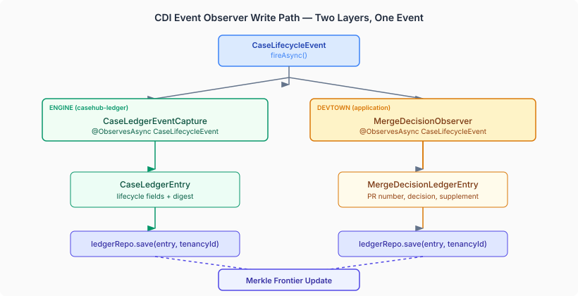
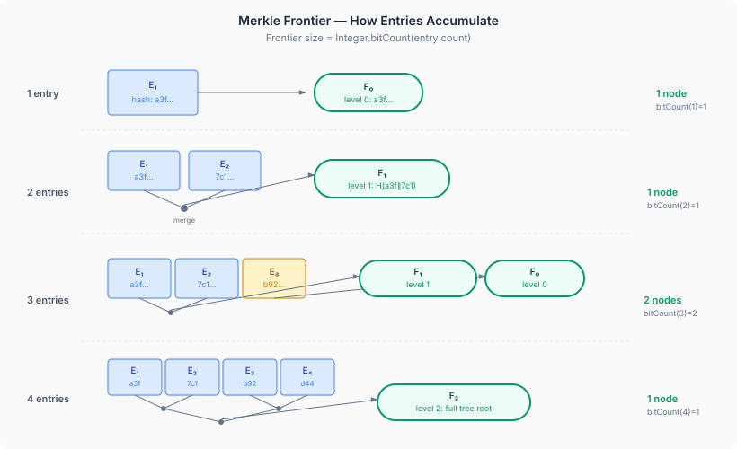

# The Write Path Nobody Tested

Yesterday I wrote about the audit trail nobody reads — compliance evidence that existed as API responses no human ever called. Today I found the mirror problem: the write path nobody tested.

DevTown has had `casehub.ledger.enabled=true` in production configuration since Layer 4 shipped. The engine's `CaseLedgerEventCapture` observes every `CaseLifecycleEvent` and writes a `CaseLedgerEntry`. `WorkerDecisionEventCapture` observes every `WorkerDecisionEvent` and writes a `WorkerDecisionEntry` with trust score and routing rationale. Every `save()` call computes a SHA-256 digest and advances a Merkle frontier. The tamper-evidence chain exists. It has always existed.

Except in the test suite, the ledger was disabled.

`casehub.ledger.enabled=false` — line 67 of the test `application.properties`, with a comment explaining why: the `LEDGER_SUBJECT_SEQUENCE` table doesn't exist in H2's default `drop-and-create` mode. Seven tests used `LedgerEnabledTestProfile` to override this and exercise specific ledger features — merge decision recording, compliance evidence queries, GDPR erasure. Every one of those tests either seeded entries directly via `ledgerRepo.save()` or verified only the devtown-specific `MergeDecisionLedgerEntry`. None of them verified that the engine's capture beans — the ones that actually observe CDI events and write entries in production — produce anything at all.

The write path was wired. The write path was enabled. The write path was never exercised.

## The CDI Observer Gap

The issue is architectural. DevTown's CDI assembly includes beans from multiple layers. When a `CaseLifecycleEvent` fires, two independent observers receive it:

`CaseLedgerEventCapture` comes from `casehub-engine-ledger`. It's a plain Java class — no CDI annotations on the class itself — with a CDI adapter (`CaseLedgerEventCaptureAdapter`, `@ApplicationScoped`) that receives `@ObservesAsync CaseLifecycleEvent` and delegates. It checks `ledgerConfig.enabled()`, computes a sequence number, populates lifecycle fields, and calls `ledgerRepo.save()`. Same pattern for `WorkerDecisionEventCapture` and `WorkerDecisionEvent`.

`MergeDecisionObserver` comes from devtown. It's the application-level observer — it builds a `MergeDecisionLedgerEntry` with PR number, repository, commit SHA, and a `DevtownComplianceSupplement`.

Both observers fire on the same event. Both write entries through `ledgerRepo.save()`. Both entries contribute to the same Merkle frontier for that subject. The existing test suite verified the application observer and ignored the engine observer entirely.

This is the kind of gap that CDI makes easy to create. The beans are discovered automatically. They appear in the container. They satisfy their injection points. Everything compiles. Everything deploys. The gap is invisible unless you ask the right question: "Does this observer actually write anything when an event fires in this assembly?"

## What a Merkle Frontier Actually Does

The Merkle frontier is the tamper-evidence mechanism. Every time `ledgerRepo.save()` writes an entry, it computes a SHA-256 digest from the entry's domain content and updates a set of frontier nodes for that subject. The frontier is a compact representation of a Merkle tree built incrementally — you don't need to store the full tree, just the frontier nodes that would be needed to extend it.

The number of frontier nodes for a subject with N entries is `Integer.bitCount(N)` — the number of 1-bits in the binary representation of N. One entry: `bitCount(1) = 1` node. Two entries: `bitCount(2) = 1` node (the two leaf hashes merged into a single level-1 hash). Three entries: `bitCount(3) = 2` nodes (a level-1 merged hash plus an unpaired level-0 hash). Four entries: `bitCount(4) = 1` node (a full binary tree with one root).

This is a mathematical invariant. If you have three ledger entries for a subject and the frontier has one node instead of two, something is wrong — an entry was deleted, a hash was recomputed, or the write path failed silently. The invariant is what makes the chain tamper-evident: you can verify the structural integrity of the audit trail with a single count-and-compare, without replaying every hash computation.

None of the existing tests queried the frontier. None of them verified this invariant.

## What We Verified

I brought Claude in to help close this gap. We wrote three changes:

**`MergeDecisionObserverTest` — extended.** The existing test fires `CaseLifecycleEvent` and checks that `MergeDecisionLedgerEntry` appears. We added a parallel assertion: after the same event, a `CaseLedgerEntry` must also exist (written by the engine's capture bean, not devtown's observer), with a non-null digest and a Merkle frontier with non-null hashes. One event, two layers verified.

**`WorkerDecisionWritePathTest` — new.** Fires a `WorkerDecisionEvent` with a known `workerId` and `capabilityTag`, asserts that `WorkerDecisionEntry` appears with the correct fields and a computed digest, and verifies the frontier has exactly `bitCount(1) = 1` node. A second test fires three events for the same case and verifies `bitCount(3) = 2` frontier nodes. This uses `TrustScoringTestProfile` — the profile that enables trust scoring alongside the ledger — so the capture bean populates trust enrichment fields from the real `TrustScoreSource` and `TrustRoutingPolicyProvider`.

**`GdprErasureResourceTest` — extended.** The existing erasure test seeded entries directly. We added a test that creates entries through the capture path — firing a `CaseLifecycleEvent` so the entry gets a real digest and real frontier nodes — then runs erasure and verifies that the frontier persists (erasure pseudonymises actor fields; it doesn't delete entries) and the erasure receipt has a valid digest. This is the tamper-evident receipt: proof that an erasure happened, recorded in the same chain that the erasure modified.

## Why This Matters Outside DevTown

Automated code review is production infrastructure now. The question isn't whether AI agents will review code — they already do. The question is whether the decisions those agents make are auditable after the fact.

An audit trail that isn't tested is an audit trail that might not exist. "The beans are wired and the config is enabled" is not evidence that entries are written. "We have a `LedgerEnabledTestProfile`" is not evidence that the write path works. Evidence is a test that fires the event, queries the result, and checks the invariant.

The Merkle frontier makes this concrete. If a regulatory audit asks "can you prove that this merge decision record hasn't been tampered with since it was written?", the answer is either "yes, here's the frontier — the bitCount invariant holds" or it's "we think so, because we enabled the config flag." One of those answers satisfies Article 12. The other invites follow-up questions you'd rather not face.

The seven existing tests proved that devtown can write ledger entries and query compliance evidence. What they didn't prove is that the production write path — the path where CDI events fire and engine observers write entries with computed digests and advancing frontiers — actually works in devtown's assembly. That's the gap between "the feature exists" and "the feature works." Testing closed it.
