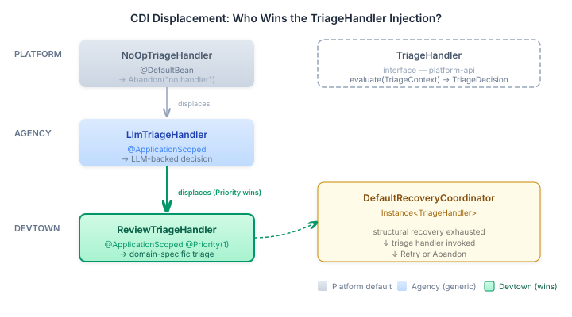
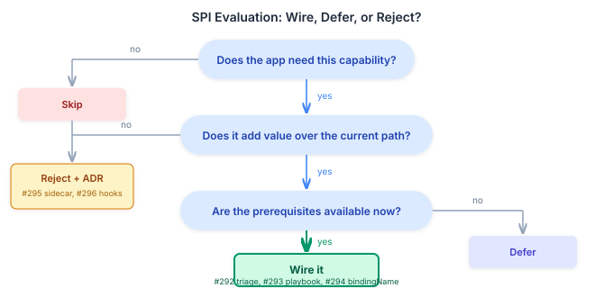

# The SPIs That Were Already There

Five foundation SPIs shipped across CaseHub over the past few months. Three of them needed wiring. Two didn't. Knowing which is which matters more than the wiring itself.

The epic started with five open issues: TriageHandler for intelligent failure recovery, PlaybookWorkerFunctionProvider for YAML-defined worker behaviour, SubCaseGroup.bindingName for richer sub-case metadata, an HTTP agent sidecar evaluation, and a protocol lifecycle hooks evaluation. All five had clean foundation contracts. All five had default implementations. The question for each was the same: does devtown gain anything by wiring this?

Three times the answer was yes. Twice it was no — and the "no" decisions are as important as the "yes" ones.

## The Displacement Stack

CaseHub's CDI displacement pattern is load-bearing architecture, not a CDI trick. The platform ships a `NoOpTriageHandler` as `@DefaultBean`. It always returns `Abandon("no triage handler configured")`. If you never wire anything else, structural recovery exhausts and the case stalls. That's correct behaviour for an application that hasn't decided what failure triage means in its domain.

The agency module ships `LlmTriageHandler` as `@ApplicationScoped` — a generic implementation that serialises the failure context into an LLM prompt and parses the response into Retry or Abandon. It displaces the NoOp automatically when agency is on the classpath. No configuration. No feature flag. CDI priority does the work.

Devtown needs something different. A PR review that gets DECLINED because the agent lacks security expertise shouldn't go to an LLM for a decision — it should re-route to the next trust-ranked candidate. A reviewer that times out on the first attempt should retry. A reviewer that times out three times running should escalate to a human. These are domain rules, not LLM inference problems.



`ReviewTriageHandler` sits at the top of the stack with `@Priority(1)`. It parses the failure summary string — the same string `DevtownFailureClassifier` already parses for structural recovery — and classifies into three buckets: declined (always retry, the engine re-routes), unrecoverable (abandon immediately), and everything else (retry while budget remains, abandon when exhausted). The engine already excludes the failed worker from future dispatch, so a retry with an empty modifications map is sufficient to trigger re-routing.

The critical insight: the handler doesn't need to know about trust scores, routing policies, or reviewer capabilities. Those live in the selection strategy. The triage handler's job is narrower — decide whether to try again or give up. The domain knowledge is in the classification, not in the resolution.

## Playbooks: Configuration Over Code

The second SPI tells a different story. `PlaybookWorkerFunctionProvider` handles YAML worker definitions with a `steps:` block — open an agent session, query it, close the session. The engine's `RuntimeBeans` collects all `WorkerFunctionProvider` CDI beans into a registry. But `PlaybookWorkerFunctionProvider` ships as a plain class with no CDI annotations. Unlike the flow, react, MCP, and A2A providers — each of which has a dedicated Quarkus extension module with a `*Beans.java` producer — playbooks have no extension module.

So devtown creates the producer:

```java
@Produces
@ApplicationScoped
PlaybookWorkerFunctionProvider playbookWorkerFunctionProvider() {
    return new PlaybookWorkerFunctionProvider();
}
```

Five lines. But those five lines are the difference between "the engine supports playbook workers" and "devtown can define review behaviour in YAML." The style-review playbook is the proof of concept — three steps that open an agent session with a style review system prompt, query it with the PR diff, and close the session. The playbook compiler turns that into a Serverless Workflow that the engine dispatches like any other worker.

The practical value isn't for style review specifically. It's for the next capability someone wants to add. Instead of writing a Java `ReviewerAgent` implementation, registering it in the agent registry, and rebuilding the module — they write a YAML file and drop it into `review/src/main/resources/devtown/playbooks/`. Configuration over code. The agent session steps handle the LLM interaction; the playbook compiler handles the workflow orchestration.

## The Field That Was Already Populated

The third SPI is the simplest and the most instructive. Engine #1260 added `bindingName` to `SubCaseGroup`. The engine's `SubCaseExecutionHandler` already passes the binding name through to the repository when creating sub-case groups. The `InMemorySubCaseGroupRepository` already stores it. The JPA repository already persists it. The field was populated end-to-end in the foundation.

Devtown's merge queue creates bisection sub-cases (`bisect-left`, `bisect-right`) through its YAML case definition. The engine populates their binding names automatically. But devtown's governance query layer — the API that feeds the merge queue workbench — never queried the sub-case groups at all. The `batchStatus()` method returned PR entries and batch metadata. Sub-case structure was invisible.

Adding `BisectionSubCase` to `BatchStatus` and querying `SubCaseGroupRepository.findAllByParentCaseId()` took three files and seventeen lines of change. The data was there. The query path existed. The field was populated. Nobody had connected the last mile.

## The Two That Weren't Worth Wiring

Not every SPI that ships should be adopted. The remaining two issues in the epic were evaluations, and both ended as rejections with ADRs.



**HTTP agent sidecar (ADR-0002).** Platform #666 shipped `agent-http` — a structured HTTP endpoint wrapping `AgentProvider.invoke()`. The issue title said "sidecar" but the implementation is an in-JVM REST API layered on top of the same `AgentProvider` that devtown already calls directly through `StructuredAgentInvoker`. Adopting it would add HTTP serialization overhead for zero functional gain. The endpoint exists for external integrations and functional testing of deployed agents — not for in-process use by domain applications.

The only scenario where it would matter is if reviewer agents ran out-of-process. That's a deployment topology decision, not an SPI wiring decision. Rejected.

**Protocol lifecycle hooks (ADR-0003).** Qhorus #497 shipped `ProtocolLifecycleHandler` with `onInit` and `onDestroy` callbacks for channel-level protocol state. The idea was to use it for review round tracking — reviewer requests changes, contributor pushes, reviewer re-reviews. But devtown manages review interaction state through CasePlanModel bindings that fire on context predicates. These are different abstraction levels. The CPM already handles the current model: single-shot dispatch, outcome policy rerouting, scope reduction, human escalation. Adding protocol hooks would create a parallel state management path with no benefit.

If multi-round review is needed later, it belongs as a CPM binding pattern — a binding that re-fires when the PR diff changes. Not as a qhorus protocol hook. Rejected.

The rejections are part of the work. An evaluation that closes as "rejected with ADR" is not a failed evaluation — it's a design decision that prevents unnecessary complexity from entering the codebase. The ADR documents why, so the next person who asks "should we use protocol lifecycle hooks?" gets a reasoned answer instead of starting from scratch.

## What the Full Epic Teaches

The five SPIs split into two categories. Three needed domain-specific implementations — triage classification, playbook producers, sub-case metadata surfacing. Two didn't — they solved problems devtown doesn't have.

The three that were wired follow the same arc: foundation ships a capability with a safe default. Agency adds a generic implementation. The domain application wires the domain-specific version. Each layer can function without the layers above it. Each layer above adds value without modifying the layers below.

The two that were rejected follow a different arc: foundation ships a capability that looks applicable. Evaluation reveals that devtown's existing path already covers the use case without the SPI — or that the SPI operates at the wrong abstraction level for the domain.

This is the argument for the entire CaseHub architecture. A healthcare triage handler would classify differently — medication interaction failures are never retry-safe. A legal compliance handler would classify differently — regulatory deadline breaches require immediate human escalation regardless of attempt count. The TriageHandler interface doesn't know about any of these domains. The displacement pattern doesn't care. The same CDI mechanism that makes `ReviewTriageHandler` win in devtown makes `LegalTriageHandler` win in a compliance application, with zero changes to the platform, zero changes to the engine, and zero changes to the agency.

But a healthcare application would also reject the HTTP agent sidecar for the same reason devtown did — its agents are in-JVM. The evaluation process and the rejection reason transfer. That's the real value of documenting the "no" alongside the "yes."

The platform's job is to ship the extension point and the safe default. The application's job is to express its domain knowledge through that extension point — or to document why a particular extension point doesn't apply. The gap between them is either wiring or a deliberate decision. Both are work. Both need to be recorded.
